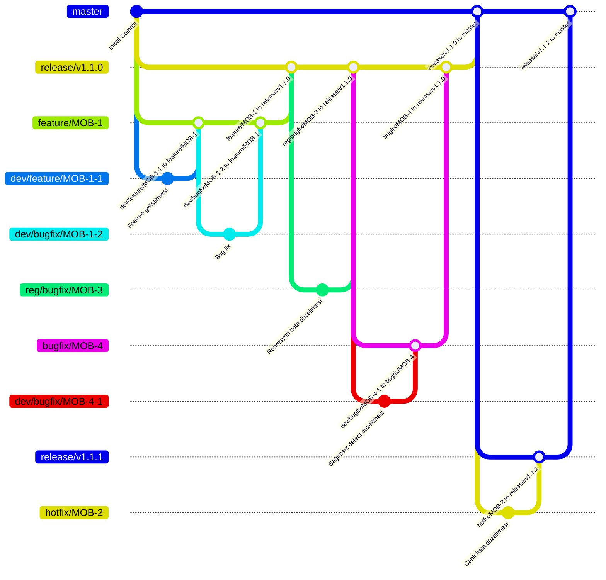
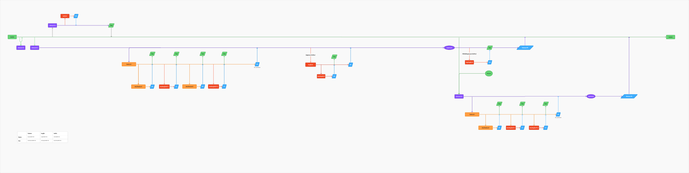

## Branch ve PR akışı

### Master (`master`)

- Ana branch'tir ve korunur; doğrudan commit atılmaz.
- Release branch'leri bu branch'ten oluşturulur.
- Tamamlanan `release/*` branch'lerinden PR ile değişiklik alır.

### Release (`release/*`)

- `master` branch'inden oluşturulur.
- Korunur; doğrudan commit atılmaz.
- İlgili feature branch'leri bu branch'ten oluşturulur.
- Doğrulanan `feature/*` branch'lerinden PR ile değişiklik alır.
- Feature'dan bağımsız defect'ler için bu branch'ten `bugfix/*` branch'leri oluşturulur; testten geçen düzeltmeler PR ile geri alınır.
- Regresyonda bulunan hatalar için bu branch'ten `reg/bugfix/*` branch'leri oluşturulur; düzeltmeler PR ile geri alınır.
- Hotfix sürümlerinde ilgili `hotfix/*` branch'inden PR ile düzeltme alır.
- Release tamamlandığında `master` branch'ine PR açılır.

### Feature (`feature/*`)

- İlgili `release/*` branch'inden oluşturulur.
- Korunur; doğrudan commit atılmaz.
- `dev/feature/*` ve `dev/bugfix/*` çalışma branch'leri bu branch'ten oluşturulur.
- Çalışma branch'lerinden yalnızca PR ile değişiklik alır.
- Test/QA doğrulamasından sonra ilgili `release/*` branch'ine PR açılır.

### Dev Feature (`dev/feature/*`)

- İlgili `feature/*` branch'inden oluşturulur.
- Feature geliştirmeleri bu branch'te yapılır ve commit'ler bu branch'e atılır.
- Değişiklikler için ilgili `feature/*` branch'ine PR açılır.

### Dev Bugfix (`dev/bugfix/*`)

- Feature'a ait hatalar için ilgili `feature/*` branch'inden, bağımsız defect'ler için ilgili `bugfix/*` branch'inden oluşturulur.
- Testte bulunan bug'lar bu branch'te düzeltilir ve commit'ler bu branch'e atılır.
- Düzeltmeler için oluşturulduğu `feature/*` veya `bugfix/*` branch'ine PR açılır.

### Bağımsız Defect Bugfix (`bugfix/*`)

- Feature'dan bağımsız defect'ler için ilgili `release/*` branch'inden oluşturulur.
- Korunur; doğrudan commit atılmaz. Düzeltmeler için bu branch'ten `dev/bugfix/*` branch'i oluşturulur.
- Düzeltmeler `dev/bugfix/*` branch'inden PR ile alınır.
- Test/QA doğrulaması başarılı olduktan sonra ilgili `release/*` branch'ine PR açılır.
- Bu akış release `master`'a alınmadan önce tamamlanır.

### Regresyon Bugfix (`reg/bugfix/*`)

- Release `master`'a alınmadan önce regresyonda bulunan hataları düzeltmek için ilgili `release/*` branch'inden oluşturulur.
- Düzeltmeler bu branch'te yapılır ve commit'ler bu branch'e atılır.
- Düzeltmelerin doğrulanmasının ardından ilgili `release/*` branch'ine PR açılır.
- Regresyon tamamlandıktan sonra release branch'inden `master`'a PR açılır.

### Hotfix (`hotfix/*`)

- Canlıdaki hataları düzeltmek için `master`'dan yeni bir `release/*` branch'i oluşturulur (örnek: `release/v1.1.1`).
- Hotfix branch'i bu release branch'inden oluşturulur (örnek: `hotfix/MOB-2`).
- Düzeltmeler hotfix branch'inde yapılır ve commit'ler bu branch'e atılır.
- Test/QA doğrulamasından sonra ilgili release branch'ine PR açılır.
- Düzeltme release branch'ine alındıktan sonra release branch'inden `master`'a PR açılır.

### Ortak PR ve test kuralları

- PR açılmadan veya güncellenmeden önce kaynak branch, hedef branch'in son değişikliklerini içerecek şekilde güncellenir.
- Test/QA bir doğrulama adımıdır; ayrı bir test branch'i oluşturulmaz.

### Akış diyagramı

---

### Akış Diyagramı (Figma Görünümü)

Tam boyutta görüntülemek için: [git guideline](./git-guideline.svg)
